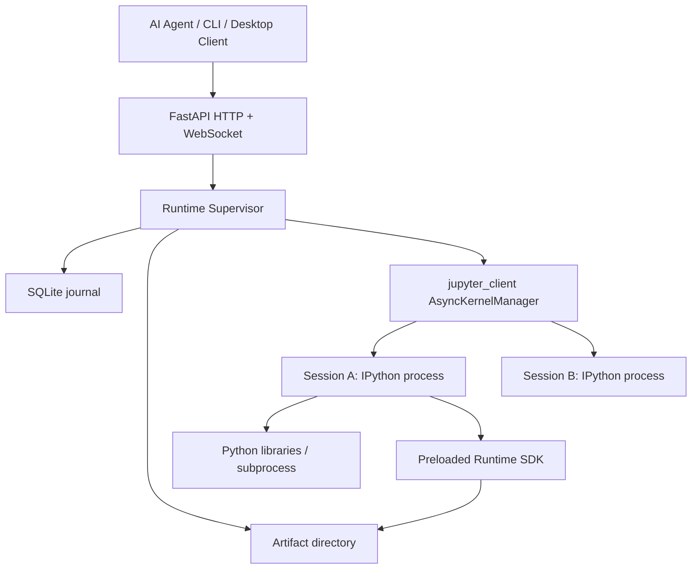
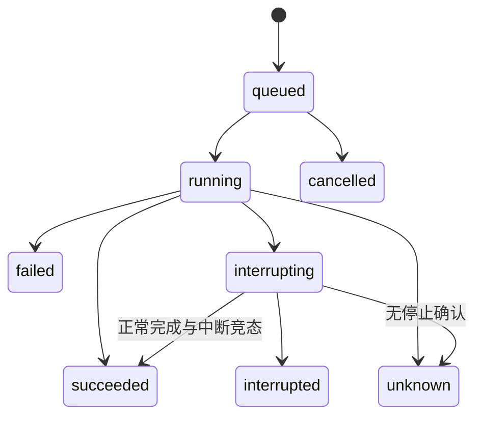

# AI Runtime v0.1 框架设计

## 目标与范围

让 AI 使用普通 Python 代码在用户电脑上连续工作。运行时的职责是维持会话、可靠执行和记录证据；Agent 负责生成代码、理解结果和判断任务是否完成。

首版采用可信本机模式：Windows、单用户、本机回环访问。通过真实 IPython kernel 实现，不自行编写解释器，也不依赖 Notebook UI。

## 组件与边界



| 模块 | 实现 | 责任 |
|---|---|---|
| API | `src/ai_runtime/api.py` | 鉴权、输入校验、会话/执行接口、事件流、产物下载 |
| 执行内核 | `src/ai_runtime/engine.py` | kernel 生命周期、队列、消息关联、超时、中断、健康检查 |
| 存储 | `src/ai_runtime/store.py` | SQLite 历史、事件游标、单实例锁、服务启动恢复标记 |
| Kernel SDK | `src/ai_runtime/sdk.py` | 显式 JSON 检查点、文件产物 |
| 客户端 | `src/ai_runtime/client.py` | 提交、等待、读取事件；与执行进程解耦 |
| 入口 | `src/ai_runtime/__main__.py` | token 创建、回环监听、服务生命周期 |

## 数据模型

- Session：稳定 ID、工作目录、状态、generation、创建时间。
- Execution：执行 ID、session_id、request_id、代码、超时、状态、原因、创建时间。
- Event：递增 seq、session_id、execution_id（可为空）、kind、JSON payload、时间。
- Artifact：产物 ID、session_id、路径、MIME、大小。

状态与输出先写 SQLite，再由 HTTP/WS 提供。WS 按数据库游标读取，客户端断线不影响 kernel，重连可从最后收到的 seq 补读。允许客户端重复读取事件，由 seq 去重，不宣称恰好一次送达。

数据目录：

```text
.runtime/
  token
  daemon.lock
  runtime.sqlite3
  sessions/<session-id>/
    connection.json
    checkpoint.json
    artifacts/<random-id>.<extension>
```

connection.json 包含 kernel 连接信息，和 token 一样属于本机敏感配置，不通过 API 暴露。

## 代码执行生命周期

1. API 校验 token、工作目录与请求格式。
2. 创建 IPython 子进程，等待 ready，导入 runtime SDK。
3. 提交代码先查 `(session_id, request_id)`，同参数返回原执行；不同参数拒绝。
4. 写入 queued 记录，再进入会话内 asyncio 队列。
5. 单独 worker 向 Jupyter shell 通道发送 execute_request；禁止 stdin 阻塞。
6. shell 和 IOPub 各自有持续接收任务，按 parent_header.msg_id 关联执行。
7. 只有 execute_reply 和该请求对应的 idle 均收到，才确认前台执行结束。
8. 持续接收后台输出，不因前台执行结束就停止订阅。



`succeeded` 只说明代码执行成功。是否真的修好了视频、发出了消息或得到预期网页，由 Agent 根据独立证据判断。

## 超时、中断、丢失

超时从实际 dispatch 开始计时，不包含排队时间。超时或手动中断通过 Jupyter manager 请求中断。最多等待 5 秒确认；无法确认时会话进入 lost，当前执行 unknown，后续排队代码 cancelled，拒绝新提交。

此时 kernel 可能仍然存活，外部副作用也可能已发生。必须由调用者核实结果并显式 restart，不自动重试原代码。健康任务检测 kernel 进程退出时采用同样的 unknown 语义。

Windows 的 `_thread.interrupt_main` 对部分底层阻塞调用不能即时生效。因此测试分别覆盖可中断的 Python 循环，以及无法确认中断的路径；不将“已发送中断”当作“已停止”。

## 恢复语义

| 场景 | 内存 | 行为 |
|---|---|---|
| HTTP/WS 客户端重连 | 保留 | 按 session_id 继续提交、按 seq 补读 |
| kernel 崩溃 | 丢失 | 当前执行 unknown，会话 lost |
| 显式 restart | 丢失 | generation 加一；加载 SDK，不重放历史 |
| 服务正常退出 | 关闭 kernel | 保留日志、产物和检查点 |
| 服务重新启动 | 不承诺保留 | 旧存活状态置 lost；在途执行 unknown；排队执行 cancelled |

第一版没有实现服务崩溃后的 kernel 重新附着，也不序列化 Python 对象。检查点仅保存业务显式声明的 JSON 数据。重建连接时应再次验证目标应用身份，而不是复用已经失效的句柄。

## 权限与隔离

首版不是强隔离运行环境。kernel 使用当前用户权限，任意 Python 代码可直接调用文件、网络和子进程。因此 token 是 API 接入认证，不能防御同用户下的恶意代码；SDK 路径检查也不构成整个系统的沙箱。

服务固定监听 127.0.0.1，不允许通过 CLI 切换为公网监听。HTTP/WS 共用 Bearer 身份验证。一个数据目录只能由一个服务持有。产物下载重新检查路径范围，始终返回附件。

后续受限模式必须用 OS 隔离边界实现，并将宿主操作放到独立能力代理中；不能只在 Python SDK 里检查权限。

## 资源与预算

当前默认限制：最多 8 个 live session，每会话最多 100 个排队执行；代码长度 256 Ki 字符；执行超时 0.1 到 3600 秒；每次执行持久化输出 4 MiB。

输出预算只保护正常调用下的持久化规模，不是进程内存、CPU、磁盘配额。SDK 显式文件产物尚无大小配额，历史记录尚无清理策略。超大单条 Jupyter 消息会先被接收，再被预算丢弃。

## 后续演进

### 阶段 1：可运行执行核心（本次实现）

会话、队列、变量保留、事件、产物、检查点、token、客户端、真实 kernel 测试。

### 阶段 2：电脑工作环境

先实现 DevTools 连接与 ADB 截图适配器，通过 Python API 暴露。资源注册表保存目标身份、所属 session 和重连方式；添加应用级互斥锁。再增加后台订阅、结构化事件和 Agent 唤醒协议。

普通脚本能力继续交给 Python 标准库，不把所有库重新包装成工具。

### 阶段 3：可靠运维与受限执行

Windows Job Object/其他系统资源约束、磁盘与内存配额、历史清理、kernel 环境版本记录、资源代理、细粒度授权。审慎增加 daemon 重连能力，不自动重放带副作用的代码。

## 验证与参考

回归测试位于 `tests/test_runtime.py`，真实启动 IPython，覆盖持久状态、隔离、后台输出、去重、中断、失联、重启和 HTTP/WS。

协议依据：
- [Jupyter messaging](https://jupyter-client.readthedocs.io/en/stable/messaging.html)
- [AsyncKernelClient](https://jupyter-client.readthedocs.io/en/stable/api/jupyter_client.asynchronous.html)
- [FastAPI lifespan](https://fastapi.tiangolo.com/advanced/events/)

## 本地 MCP Adapter（后续已实现）

新增 `src/ai_runtime/mcp_server.py`：官方 MCP STDIO → loopback HTTP → 原有 Runtime，不进入数据库或 kernel 生命周期。支持 18 个工具（12 个基础工具和 6 个插件工具），包含执行去重参数、事件游标及原生图片内容。Adapter 重启不影响 kernel，会话归 Runtime 管理。完整使用方式与远程接入边界见 [mcp.md](mcp.md)。

## 本地插件 v1

插件清单持久化到数据目录 plugins.sqlite3；守护进程只读元数据及提交任务。插件在 kernel 内创建，按会话缓存实例，通过 create(context)、call(action, arguments)、close() 管理。具体见 [插件接口](plugins.md)。效果实现位于 plugins/effects，examples 只保留使用演示。
